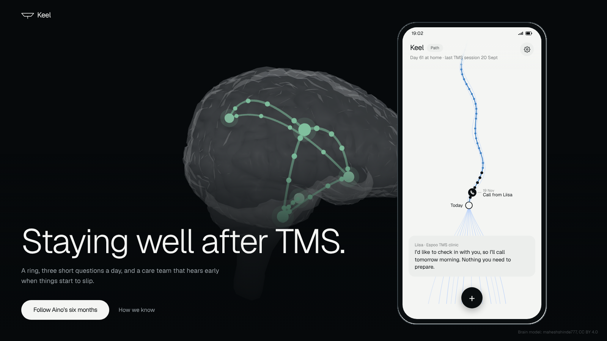

<div align="center">

<a href="https://keel-q220.onrender.com"></a>

# Keel

**Staying well at home after TMS for depression.**

[**Try the live demo**](https://keel-q220.onrender.com) · [Read the whitepaper](docs/paper/keel.pdf) · [Watch the demo video](https://keel-q220.onrender.com/keel-demo.mp4)

Junction 2026 · Aalto NBE challenge *Help people stay well at home after depression treatment*

</div>

---

## The problem

Transcranial magnetic stimulation (TMS) lifts depression for many people that medication did not help.
The hard part comes after: about half of those who recover relapse within a year, and most of that
slide happens at home, between clinic visits, where nobody is looking. Fixed monthly boosters cost
clinic time for people who don't need them and still miss people who do.

## What Keel does

Keel is a closed loop for the months after a TMS course: it **senses** how someone is doing,
**forecasts** relapse two weeks ahead, **suggests** one or two small things each day, **learns** what
actually helps that person, and **tells the clinic** who needs a call or a booster before a crisis.

| Who | What they see |
|---|---|
| **The patient** | One notification a day with three short questions, their path since discharge, and what has been helping them. Never a risk number. |
| **The nurse** | A weekly call list ranked by risk, with the reasons behind each name and one-click booster booking. |
| **Keel** | The ring's sleep, rhythm, activity and heart rate variability, compared with the person's own normal, plus every answer. |

## What's new

- **A digital shadow of each patient.** A mechanistic model of how the TMS benefit fades, how stress
  and life events push symptoms, and how small daily actions push back. It is calibrated to published
  relapse rates and personalised from the person's own data.
- **The body speaks first.** The ring's signals, compared with the person's own baseline from the last
  two weeks of TMS, are turned into the same units as their answers. In a hard week they move before
  the person says anything is wrong.
- **Boosters when they matter, not by calendar.** The forecast times a short booster block instead of
  a fixed schedule: 0.7 blocks per person in six months rather than six.
- **It learns what helps each person** with Bayesian updating on their own days, starting from what
  helps most people.
- **It explains itself.** Every warning comes with the signals that drove it (SHAP attributions), so
  the nurse knows what to ask about.
- **Questions that don't lead.** Three items a day, structured like the Beck Depression Inventory,
  21 topics over a week, each starting from "about as usual". A safety item opens a crisis path.

## How it scales

- **Cheap to run.** A full 180-day patient, simulated twice, takes about half a second on one CPU core;
  the server runs in about 100 MB of memory.
- **Light on clinic time.** In a caseload of 14 discharged patients, the list says who needs a call this
  week (two, in the demo) and lets the nurse leave everyone else alone.
- **Light on patients.** Under a minute a day, plus a ring they wear anyway.
- **Hardware-agnostic.** Any wearable that reports sleep, steps and heart rate variability works; an
  Oura importer is included.
- **Useful from day one.** Personal models start from the population and sharpen as the person's own
  days come in.

## What it is built on

- **Clinical evidence:** the rTMS durability meta-analysis (Senova et al. 2019) for relapse rates, and
  the maintenance rTMS literature showing rescue boosters outperform fixed schedules.
- **Questionnaire structure:** the Beck Depression Inventory, rewritten in our own neutral wording.
- **Real wearable data:** PSYCHE-D (Makhmutova et al. 2021), 7 291 three-month windows from 3 069
  people, to check what a ring alone can and cannot tell.
- **Our earlier project:** [StimIQ](https://github.com/Latt33/StimIQ), a digital shadow for deep brain
  stimulation, where the approach started.
- **Stack:** Python, NumPy and FastAPI for the model; scikit-learn and SHAP for explanations; React,
  Three.js and Tailwind for the web app.

## How it performs

300 simulated patients over 180 days, each living the same life (same stress, same noise) under four
kinds of care. The untreated arm matches published relapse rates (66.5 % and 52.9 % still in
response at 3 and 6 months).

<div align="center">

| Care | Relapse-free at 6 months | Days spent relapsed | Booster blocks per person |
|---|:---:|:---:|:---:|
| Usual care (nothing until the next visit) | 56 % | 41.8 | 0 |
| Same healthy-habits plan for everyone | 66 % | 29.2 | 0 |
| Keel plan only (no clinic escalation) | 70 % | 24.3 | 0 |
| **Keel** | **89 %** | **2.4** | **0.69** |

</div>

- **Earlier warning.** AUC 0.94 for "relapses within 14 days", against 0.91 for check-ins alone. At the
  same 10 % false-alarm rate, the median warning comes **23 days** before relapse instead of 16.
- **Personal learning.** After six months, Keel's two favourite activities for a person are in that
  person's true top three 83 % of the time, against 59 % for the population guess.
- **Honest about real data.** On PSYCHE-D, consumer wearables alone barely beat a coin flip three
  months ahead (AUC 0.60; the questionnaire alone 0.79). That is why Keel compares each person with
  their own normal, looks two weeks ahead, and always pairs the ring with a check-in. The simulator's
  numbers are an upper bound; [HONESTY.md](HONESTY.md) lists every assumption.

## How to use it

**Online:** open the [live demo](https://keel-q220.onrender.com) and press *Follow Aino's six months*.
The free server sleeps after 15 idle minutes, so the first visit can take about a minute.

**Locally** (Python 3.11+ and Node 20+):

```bash
python -m pip install -r backend/requirements.txt
npm install && (cd frontend && npm install)
npm run dev                      # API on :8000, app on http://localhost:5180
```

**With Docker:**

```bash
docker build -t keel . && docker run -p 8000:8000 keel   # http://localhost:8000
```

On [Render](https://render.com), choose **New → Blueprint** and pick this repository; `render.yaml`
sets up a free web service.

<details>
<summary><b>Reproduce the numbers and the whitepaper</b></summary>

```bash
python -m pip install -r backend/requirements-research.txt
cd backend
python -m pytest -q                                               # model and API tests
python -m scripts.evaluate 300                                    # cohort results
python -m scripts.psyched_baseline ../data/anon_processed_df_parquet
python -m scripts.paper_figures ../data/anon_processed_df_parquet  # whitepaper figures
```

The PSYCHE-D file is not committed (CC BY-NC licence); `data/README.md` has the download command.
Rebuild the paper with `latexmk -pdf keel.tex` in `docs/paper/`.

</details>

<details>
<summary><b>Try it with your own Oura ring</b></summary>

Put an Oura API v2 export (`sleep` and `daily_activity` JSON) or a CSV export in `data/oura/`. A
**Your ring** tab appears: the first 14 days become your normal, and every later day shows the drift
from it and the two-week outlook. At least 21 days with sleep, steps and HRV are needed.

</details>

<details>
<summary><b>Repository layout</b></summary>

```
backend/keel/       virtual patient, forecast, learner, planner, loop, items, story, clinic, live API
backend/scripts/    evaluation, forecast calibration, PSYCHE-D baseline, paper figures, Oura replay
backend/tests/      model and API tests
frontend/src/       landing, story, house (her day in 3D), phone, clinic, evidence, brain
docs/paper/         whitepaper source, PDF and figures
```

</details>

## Team

<div align="center">

**[Atte Laakso](https://www.linkedin.com/in/atte-laakso/)** · **[Konsta Kiirikki](https://www.linkedin.com/in/konsta-kiirikki/)** · **[Nikolas Juhava](https://www.linkedin.com/in/nikolas-juhava/)** · **[Qilun Li](https://www.linkedin.com/in/qilun-li-2a56ba191/)**

Aalto University School of Science

</div>

## Acknowledgments

Aalto NBE for the challenge · PSYCHE-D by Makhmutova et al. (Zenodo 5085146, CC BY-NC 4.0) ·
Brain surface from the MNI ICBM152 template (McConnell Brain Imaging Centre, MNI), via NiiVue · Geist typeface (SIL Open Font License)

<sub>Keel is a research demonstrator, not a medical device. Every patient in the demo is simulated.</sub>
