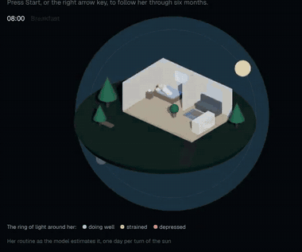
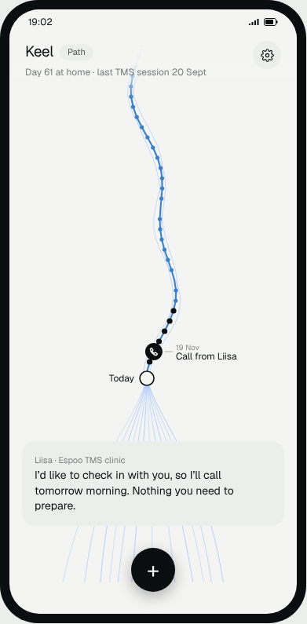
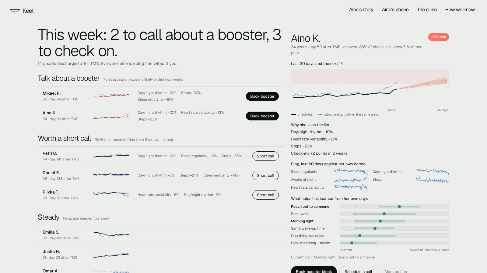
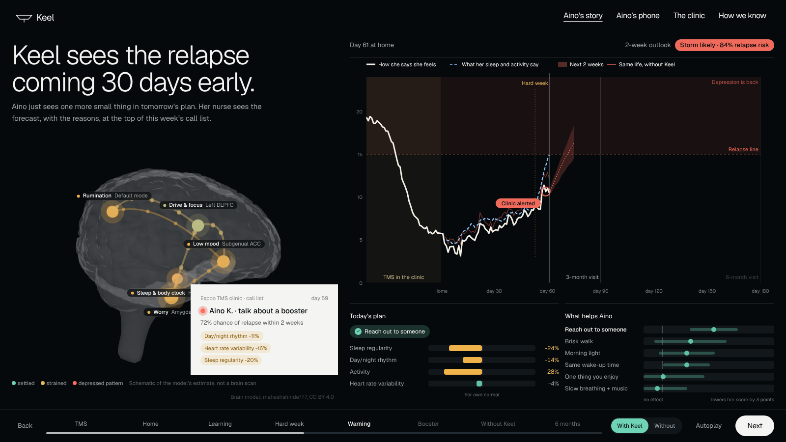

<a href="docs/demo.mp4"></a>

# Keel

**Staying well after TMS.** Keel is a closed loop for the months after a course of transcranial magnetic
stimulation (TMS) for depression. It senses how someone is doing at home, forecasts relapse two weeks
ahead, suggests a small personal plan each day, learns what actually helps that person, and tells the
clinic who needs a booster before a crisis.

Built at **Junction 2026** for the Aalto NBE challenge *Help people stay well at home after
depression treatment*.

<p>
  <a href="docs/paper/keel.pdf"><b>Read the whitepaper (PDF)</b></a> ·
  <a href="docs/demo.mp4"><b>Watch the 90-second demo</b></a> ·
  <a href="HONESTY.md">What is simulated and what is real</a> ·
  <a href="PITCH.md">3-minute pitch script</a>
</p>

## Overview

About half of the people helped by TMS relapse within a year, and most of that slide happens
between clinic visits, where nobody is looking. Keel fills that gap with three things the patient barely
notices and one thing the clinic acts on:

- **A ring** records sleep, day/night rhythm, activity and heart rate variability, compared with the
  person's own normal from their last two weeks of TMS.
- **Three questions a day** arrive as a notification. They follow the structure of the Beck Depression
  Inventory (21 topics over a week, neutral wording, each starting from "about as usual") and take under
  a minute.
- **A digital shadow** (a mechanistic model of that patient) turns both streams into a two-week relapse
  forecast and learns which small daily actions help this particular person.
- **The care team** gets a ranked call list with the reasons. The patient never sees a risk number.

| | | |
|:---:|:---:|:---:|
|  |  |  |
| **Aino's story.** One virtual patient lived twice, with Keel and without. Each turn of the sun is one day; her routine follows the model's state. | **Aino's phone.** Her path since discharge, one notification a day, and "what has been helping you" if she wants to look. | **The clinic.** Everyone discharged after TMS, ranked by who needs a call this week, with one-click booster booking. |

## How it works



| Step | What happens | Code |
|---|---|---|
| **Sense** | Three BDI-structured questions a day plus ring signals: sleep regularity, day/night rhythm, sleep efficiency, night waking, steps, HRV | `backend/keel/items.py`, `backend/keel/sim.py` |
| **Personal normal** | Baseline from the last two weeks of the TMS course; every later day is a z-score against *her* normal | `forecast.py` `Baseline` |
| **Forecast** | The body signal is converted to PHQ-9 points, then a 300-member ensemble of the next 14 days. The share of futures crossing the relapse line is the risk | `forecast.py` `Tracker` |
| **Plan** | All 63 combinations of six small activities scored on relief against minutes of effort (Pareto front). Thompson sampling picks today's plan, which grows when risk rises | `planner.py` |
| **Learn** | Bayesian regression on her own days estimates what each activity does for her, with a slow baseline so illness drift is not credited to an activity | `learner.py` |
| **Escalate** | Three high-risk days in a row put her on the clinic list with the reasons, and a five-session booster is suggested | `loop.py`, `clinic.py` |
| **Explain** | Exact linear attributions for the body signal and TreeSHAP on a risk surrogate show which signals drive each warning | `scripts/paper_figures.py` |

The full method, data streams and SHAP analysis are in the [whitepaper](docs/paper/keel.pdf).

## Results

300 virtual patients over 180 days, each living the same life (same stress, same noise) under four
policies. The untreated arm is calibrated to the rTMS durability meta-analysis (Senova et al. 2019:
66.5 % and 52.9 % still in response at 3 and 6 months).

| Policy | Relapse-free at 6 months | Days spent relapsed | Booster blocks per person |
|---|:---:|:---:|:---:|
| Usual care (nothing until the next visit) | 56 % | 41.8 | 0 |
| Same healthy-habits plan for everyone | 66 % | 29.2 | 0 |
| Keel plan only (no clinic escalation) | 70 % | 24.3 | 0 |
| **Keel** | **89 %** | **2.4** | **0.69** |

- **Earlier warning.** AUC 0.94 for "crosses the relapse line within 14 days", against 0.91 for
  check-ins alone. At the same 10 % false-alarm rate, the median warning comes 23 days before relapse
  instead of 16.
- **Personal learning.** After six months, Keel's two favourite activities for a person are in that
  person's true top three 83 % of the time, against 59 % for the population guess.
- **Boosters when they matter.** Most of the gain comes from timing boosters, not from the habits
  plan. This matches the clinical literature, where rescue maintenance rTMS outperforms fixed schedules.

### Real-data check

On **PSYCHE-D** (Makhmutova et al. 2021, 7 291 three-month windows from 3 069 people), predicting
PHQ-9 ≥ 10 three months ahead with person-grouped cross-validation:

| Inputs | AUC |
|---|:---:|
| Fitbit sleep and steps only | 0.60 |
| PHQ-9 now only | 0.79 |
| Both | 0.78 |

A population model on consumer wearable data says little three months ahead. That is why Keel compares
each person with **their own** baseline, forecasts **two weeks** rather than three months, and always
pairs the ring with a daily check-in. The simulator's 0.94 is an upper bound under its assumptions;
the PSYCHE-D number is the floor to beat with real post-TMS data. See [HONESTY.md](HONESTY.md).

## Tech stack

- **Model and API:** Python, NumPy, FastAPI, scikit-learn and SHAP for the explanations, pytest
- **Web:** React 19, TypeScript, Vite, Tailwind CSS 4, three.js with React Three Fiber, Geist
- **Paper:** LaTeX, TikZ, Matplotlib

## Getting started

### Prerequisites

Python 3.11+ and Node 20+.

### Install

```bash
python -m pip install -r backend/requirements.txt
npm install
cd frontend && npm install && cd ..
```

### Run

```bash
npm run dev          # API on :8000 and the app on :5180
```

Open http://localhost:5180. For a single-port demo, run `npm run build`, then `npm run serve`, and
open http://localhost:8000.

### Reproduce the numbers

```bash
python -m pip install -r backend/requirements-research.txt
cd backend
python -m pytest -q                                              # model and API tests
python -m scripts.evaluate 300                                   # cohort results
python -m scripts.psyched_baseline ../data/anon_processed_df_parquet
python -m scripts.paper_figures ../data/anon_processed_df_parquet # whitepaper figures
```

The PSYCHE-D file is not committed (CC BY-NC licence); `data/README.md` has the download command.
Rebuild the paper with `latexmk -pdf keel.tex` in `docs/paper/`.

### Deploy

The repo builds into one container: the web app is compiled inside the image and the API serves it.

```bash
docker build -t keel .
docker run -p 8000:8000 keel        # then open http://localhost:8000
```

On [Render](https://render.com), choose **New → Blueprint** and pick this repository; `render.yaml`
sets up a free Docker web service with a health check. Any host that runs a Dockerfile and sets
`PORT` works the same way (Railway, Fly.io, Google Cloud Run). Each browser tab gets its own copy of
Aino's phone, so visitors of a shared link don't move each other's patient.

### Your own ring (Oura)

Put an Oura API v2 export (`sleep` and `daily_activity` JSON) or a CSV export in `data/oura/`. A
**Your ring** tab appears: the first 14 days become your normal, and every later day shows the drift
from it and the two-week outlook. At least 21 days with sleep, steps and HRV are needed.

## Repository

```
backend/keel/       virtual patient, forecast, learner, planner, loop, items, story, clinic, live API
backend/scripts/    evaluation, forecast calibration, PSYCHE-D baseline, paper figures, Oura replay
backend/tests/      model and API tests
frontend/src/       landing, story, house (her day in 3D), phone, clinic, proof, brain
docs/paper/         whitepaper source, PDF and figures
docs/screens/       screenshots of every chapter and view
```

## The team

All four of us study at the Aalto University School of Science.

- **Atte Laakso** ([LinkedIn](https://www.linkedin.com/in/atte-laakso/))
- **Konsta Kiirikki** ([LinkedIn](https://www.linkedin.com/in/konsta-kiirikki/))
- **Nikolas Juhava** ([LinkedIn](https://www.linkedin.com/in/nikolas-juhava/))
- **Qilun Li** ([LinkedIn](https://www.linkedin.com/in/qilun-li-2a56ba191/))

## Acknowledgments

- Aalto NBE for the challenge at Junction 2026
- PSYCHE-D by Makhmutova et al. (Zenodo 5085146, CC BY-NC 4.0)
- Brain model "Brain" by maheshshinde777 on Sketchfab (CC BY 4.0)
- Geist typeface (SIL Open Font License)
- Our earlier project [StimIQ](https://github.com/Latt33/StimIQ), where the digital shadow idea started

Keel is a research demonstrator, not a medical device. Every patient in the demo is simulated.
